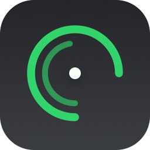

# monitorad



macOS Tahoe(26)의 시스템 HUD를 Sequoia 시절의 모습으로 되돌리고, HUD로 표시되는 시스템
지표(볼륨·밝기)를 메뉴바에 상시 보여 주는 유틸리티입니다.

- 문제와 목표: [`docs/product/brief.md`](docs/product/brief.md)
- 결정 기록: [`docs/adr/`](docs/adr/) (0001~0004)
- 도메인 용어: [`CONTEXT.md`](CONTEXT.md)
- 실행가능성 조사: [`docs/research/tahoe-hud-feasibility.md`](docs/research/tahoe-hud-feasibility.md)

## 현재 상태 (v0.1)

v0.1은 **메뉴바 인디케이터와 설정 팝오버만** 제공합니다.

- 메뉴바에 볼륨·디스플레이 밝기를 링으로 상시 표시합니다. 지표 1개는 큰 링, 2~3개는 작은 링을 나란히 그립니다.
- 팝오버에서 표시 지표 선택(최대 3개·최소 1개), 드래그 순서 변경, HUD 표시 시간(0.5~2.0초),
  로그인 시 시작, HUD 대체 토글(저장만), 종료를 지원합니다.
- 메뉴바 전용 앱(`LSUIElement`)이라 Dock 아이콘이 없습니다.

**아직 없는 것**: legacy HUD 오버레이, 미디어 키 가로채기(replacement 모드), 키보드 백라이트,
배터리 지표. HUD 표시 시간과 HUD 대체 토글은 v0.1에서 값만 저장하고 v0.2에서 사용합니다.
(로드맵은 [`docs/product/brief.md`](docs/product/brief.md) 참고)

## 요구 사항

- macOS 26 이상 (arm64)
- Xcode 26
- [XcodeGen](https://github.com/yonaskolb/XcodeGen) 2.48.0 — `project.yml`에서 프로젝트를 재생성할 때만 필요합니다.
  저장소에 `Monitorad.xcodeproj`가 커밋되어 있어 XcodeGen 없이도 바로 빌드할 수 있습니다.

## 빌드·실행

### Xcode에서 실행

1. `Monitorad.xcodeproj`를 Xcode로 엽니다.
2. 스킴 `Monitorad`를 선택하고 Run(⌘R)합니다.
3. 메뉴바 오른쪽에 링 인디케이터가 나타납니다. Dock 아이콘은 없습니다.

### 터미널에서 빌드

```bash
xcodebuild \
  -project Monitorad.xcodeproj \
  -scheme Monitorad \
  -destination 'platform=macOS' \
  -derivedDataPath build/DerivedData \
  build

open build/DerivedData/Build/Products/Debug/Monitorad.app
```

### 프로젝트 재생성

`project.yml`을 수정했다면 XcodeGen 2.48.0으로 `Monitorad.xcodeproj`를 다시 만듭니다.
커밋된 `.xcodeproj`와 결과가 달라지면 CI 드리프트 검사가 실패합니다.

```bash
# 예: Homebrew로 설치
brew install xcodegen   # 2.48.0
xcodegen generate
```

## 사용법

- **메뉴바 링**: 볼륨·밝기 변화가 링에 실시간으로 반영됩니다. 음소거 상태의 볼륨 링은 비어 있습니다.
- **팝오버**: 링을 클릭하면 열립니다.
  - 지표 체크리스트: 표시할 지표를 고릅니다(최대 3개, 최소 1개). 손잡이를 드래그해 순서를 바꿉니다.
  - HUD 표시 시간: 0.5~2.0초, 0.1초 단위(현재는 저장만).
  - 로그인 시 시작: `SMAppService`로 등록합니다.
  - HUD 대체: v0.2 replacement 모드 토글(현재는 저장만).
  - Accessibility 권한이 없으면 안내 행과 "시스템 설정 열기" 버튼이 나타납니다(v0.2 키 가로채기 준비).
  - 종료: 앱을 종료합니다.

설정은 `UserDefaults`에 저장되어 앱을 다시 실행해도 유지됩니다.

## Gatekeeper 안내

배포 빌드는 Developer ID 서명·공증 없이 **ad-hoc 서명**으로 만듭니다([ADR-0004](docs/adr/0004-distribution-and-signing.md)).
다운로드한 앱을 처음 실행하면 Gatekeeper 경고가 나타날 수 있습니다. macOS 15 이상에서는
우클릭 ▸ 열기 우회가 없으므로 다음 중 하나로 허용합니다.

- **시스템 설정 ▸ 개인정보 보호 및 보안**에서 차단된 앱의 **"그래도 열기"**를 선택한 뒤 다시 실행
- 터미널에서 격리 속성 제거:

  ```bash
  xattr -d com.apple.quarantine /Applications/monitorad.app
  ```

## 권한

- **v0.1**: 권한이 필요하지 않습니다. 볼륨은 CoreAudio(public), 밝기는 private `DisplayServices`를 읽기만 합니다.
- **v0.2 예정**: 미디어 키 가로채기(replacement 모드)에는 **Accessibility 권한**이 필요합니다.
  권한이 없으면 companion 모드로 폴백하고 팝오버에 안내 행을 표시합니다.

## 개발

### 구조

```
App/MonitoradApp/        앱 타깃 (AppDelegate, NSStatusItem, NSPopover, 권한·로그인 시작)
App/Resources/           앱 아이콘 asset catalog, ko.lproj(Localizable.strings)
Packages/MonitoradCore/  AppKit 비의존 코어 (지표 추상화·설정·레이아웃·어댑터, 단위 테스트 대상)
Packages/MonitoradUI/    SwiftUI 뷰 (링 인디케이터·팝오버)
Tests/MonitoradCoreTests/ Core 단위 테스트 타깃
Scripts/                 앱 아이콘 생성 스크립트 등
```

### 테스트

```bash
xcodebuild \
  -project Monitorad.xcodeproj \
  -scheme Monitorad \
  -destination 'platform=macOS' \
  -derivedDataPath build/DerivedData \
  test
```

`MonitoradCoreTests`가 설정 규칙·지표 registry·레이아웃·어댑터 실패 경로·표시 조합 등을 검증합니다.
테스트용 목업 지표(`AdjustableMetric` 구현체)로 3링·최대 3지표 시나리오도 확인합니다.

### CI

[`.github/workflows/ci.yml`](.github/workflows/ci.yml)이 push/PR(main)에서 다음을 수행합니다.

- XcodeGen 2.48.0 재생성 후 diff가 없는지 확인(프로젝트 드리프트 검사)
- `macos-26` 러너에서 `xcodebuild build`와 `xcodebuild test`

> DSH(에이전트) 샌드박스 개발 환경에서는 중첩 sandbox 제약 때문에 로컬 전용 헬퍼
> `.tools/verify-local.sh`를 사용합니다. 이 파일은 저장소에 포함되지 않으며 일반 개발에는 필요 없습니다.

### 앱 아이콘 재생성

아이콘은 코드로 렌더링합니다. 디자인을 바꾸려면 `Scripts/generate-app-icon.swift`를 수정하고:

```bash
swift Scripts/generate-app-icon.swift
```

16/32/64/128/256/512/1024 PNG와 asset catalog `Contents.json`이 다시 생성됩니다.

## 로드맵

- **v0.1**: 스캐폴드 + 지표 추상화 + 메뉴바 인디케이터 + 팝오버 (현재)
- **v0.2**: legacy HUD 오버레이 + replacement(키 가로채기) + Accessibility/companion
- **v1.1**: 키보드 백라이트 지표 + HUD
- **v2**: 블루투스 기기 배터리 지표, 외장 모니터 밝기(DDC), 영어 localization

자세한 내용은 [`docs/product/brief.md`](docs/product/brief.md)를 참고하세요.

## 라이선스

[MIT License](LICENSE)

## 크레딧

- [volumeHUD](https://github.com/dannystewart/volumeHUD) (MIT) — legacy HUD의 동작·레이아웃 참고.
  코드는 복사하지 않았습니다.
- Apple 시스템 HUD 자산(OSDUIHelper 리소스 등)은 재배포할 수 없어 사용하지 않았습니다.
  글리프·아이콘은 실측 비율을 참고해 직접 그립니다.
